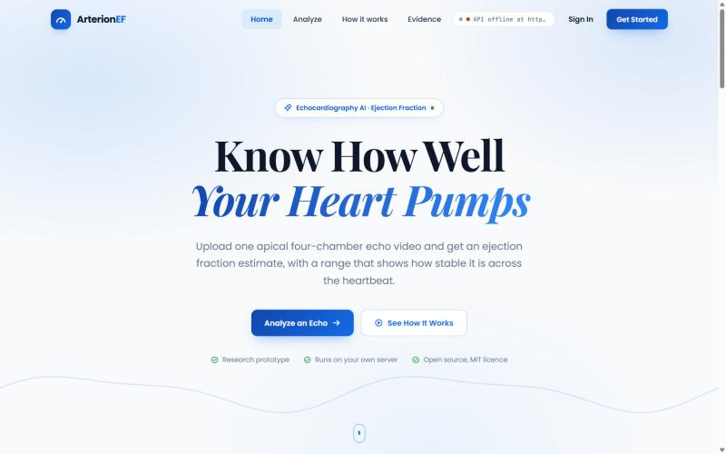
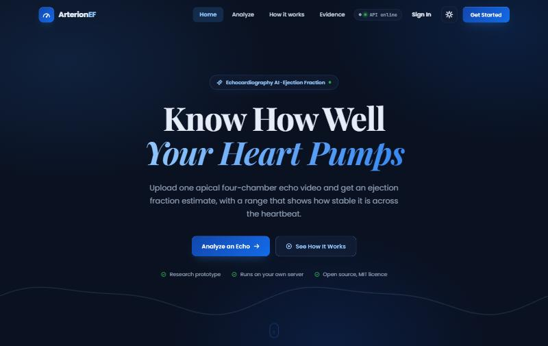

# Arterion EF Console

[](https://github.com/kartikpagariya25/arterion-ef-estimation/actions/workflows/test.yml)  

Estimates **left-ventricular ejection fraction (EF)** from an apical four-chamber echocardiogram video and shows it on a clinical gauge with the normal / mildly / moderately / severely reduced bands.



> **Research prototype — not a medical device.** Do not use for diagnosis or treatment decisions.

Part of the [Arterion](https://github.com/kartikpagariya25/Arterion) project.

## How it works

An **R(2+1)D-18** video network (Kinetics-pretrained, 31.3 M parameters) regresses EF from a 32-frame, 112×112 clip built from **every 2nd frame** (a window spans 63 frames, roughly one full heartbeat). At inference the backend scores up to **three windows** spread across the video and reports their mean; the spread between windows is shown as a stability indicator (it is not a calibrated confidence interval). Videos are resized to 112×112; short videos are padded with their last frame.

EF bands: ≥ 55 % normal · 45–54 % mildly reduced · 30–44 % moderately reduced · < 30 % severely reduced.

## Results (EchoNet-Dynamic test split, 1,277 videos)

| MAE | RMSE | R² |
|---|---|---|
| **4.61 EF points** | 6.25 | **0.739** |

Same protocol as the app: every 2nd frame, mean of 3 windows (single centre window: MAE 4.72). The previous release (v1.0.0, consecutive frames, centre window) scored MAE 5.13 / R² 0.676; this model was fine-tuned from it. These are single-centre results. The project's aim was R² ≥ 0.75 / MAE ≤ 5: MAE is met, R² is just short. `training/artifacts/metrics.json` always matches the published weights.

## Accounts, history and the doctor dashboard

Sign in from the top of the site to keep a history of your EF studys. Without an account everything still works; results just are not saved.

- **Patients** register with an email and password. Every analysis they run while signed in is saved (the findings, not images or long signals) and listed on `history.html`, together with any note a doctor adds. They can delete single analyses, change their password or delete their account and all of its data.
- **Doctors** get a dashboard on the same page: *Awaiting review*, *All analyses* (filter by type, status or patient), *Patients* and *My analyses*. They open any analysis and write a review note that the patient sees.
- **Doctor sign-up needs an invite code.** Set `DOCTOR_INVITE_CODE` on the backend; with it unset, doctor registration is disabled. To create the first doctor (or reset a forgotten password; there is no email reset):

```bash
cd backend
python -m app.accounts.cli create-user --email doc@example.com --name "Dr Doc" --role doctor
python -m app.accounts.cli set-password --email someone@example.com
```

Under the hood: SQLite, passwords hashed with scrypt, HS256 JWTs, and a lockout after five failed logins per email (15 minutes). See [SECURITY.md](SECURITY.md) for what this does and does not protect.

| Setting | Default | Meaning |
|---|---|---|
| `DATA_DIR` | `backend/data` (a Docker volume in compose) | where `arterion.db` and the generated JWT secret live |
| `JWT_SECRET` | generated once, kept in `DATA_DIR` | signing key; set it to share tokens between replicas |
| `JWT_EXPIRE_MINUTES` | `480` | token lifetime |
| `DOCTOR_INVITE_CODE` | empty (doctor sign-up off) | code required to register as a doctor |
| `REQUIRE_AUTH` | off | `1` makes every endpoint, uploads included, require a signed-in user |

| Endpoint | Who | Purpose |
|---|---|---|
| `POST /auth/register`, `POST /auth/login` | anyone | create an account / get a token |
| `GET /auth/me`, `POST /auth/password`, `DELETE /auth/me` | signed in | profile, change password, delete account and data |
| `GET /history`, `GET /history/{id}`, `DELETE /history/{id}` | signed in | the caller's own saved analyses |
| `GET /history/export.csv` | signed in | the caller's saved analyses as a CSV file |
| `GET /history/series?task=` | signed in | the headline value (ejection fraction) of each saved analysis for that task, oldest first, for charting |
| `GET /doctor/analyses/export.csv` | doctor | all analyses as CSV; filter with `patient_id`, `task`, `reviewed` |
| `GET /doctor/patients/{id}/series?task=` | doctor | the same series for one patient |
| `GET /health`, `GET /ready` | anyone | liveness, and readiness (database and upload directory) |
| `GET /doctor/patients`, `GET /doctor/analyses[/{id}]` | doctor | all patients and their analyses |
| `POST /doctor/analyses/{id}/review` | doctor | add or update a review note |

Prediction endpoints take an optional `Authorization: Bearer <token>`; when present the result is saved and the response carries an `X-History-Id` header.

## Design

The site follows one landing-page system: a floating navigation (logo mark, centre pills, sign-in, Get Started), a hero with a serif headline and an italic gradient second line, six feature cards, a four-step process, the working tool, a dark evidence section with the real held-out metrics, a call to action and a footer.

- **Palette:** royal blue and white. Tokens live in `frontend/css/theme.css`.
- **Type:** Playfair Display for headlines, Poppins for text, JetBrains Mono for numbers.
- **Motion:** GSAP ScrollTrigger drives scroll progress, reveals, the rail that connects the steps and the metric bars. Motion (the vanilla build of the Framer Motion engine) drives the hero entrance, button springs and count-ups. Everything collapses to a static page under `prefers-reduced-motion`.
- **Themes:** light and dark. The toggle in the navigation follows your system until you choose, and remembers the choice. Tokens for both live in `frontend/css/theme.css`.
- **Details:** see [DESIGN.md](DESIGN.md).



## Run it

```bash
./scripts/fetch_weights.sh        # or .\scripts\fetch_weights.ps1  (GitHub Release)
docker compose up --build
# site: http://localhost:8080     API docs: http://localhost:8000/docs
```

Without Docker: `cd backend && pip install -r requirements-dev.txt && uvicorn app.main:app --port 8000`, then serve `frontend/`. The site talks to `window.API_BASE` (`frontend/js/config.js`). No sample videos are bundled: EchoNet-Dynamic's terms do not allow redistributing its data. Note that browsers cannot play `.avi` files, so the page shows "preview not available" for them while the analysis still runs.

### API

| Endpoint | Body | Returns |
|---|---|---|
| `POST /uploads` | multipart `file` | `{file_url}` |
| `POST /ef-estimation/predict` | `{file_url}` (video) | `ejection_fraction`, `classification`, `ef_range`, `clips_used`, `frames`, `summary` |

Non-video files return 422 with a readable `detail`; empty uploads 400; files over 200 MB 413.

Tests: `cd backend && pytest tests`.

## Training

`training/src`: `dataset.py` → `train.py` (MSE, AMP, early stopping on MAE) → `evaluate.py` → `export_onnx.py` (parity-checked) → `infer.py`.

## Documentation

- [Model card](MODEL_CARD.md): data, results and limitations
- [Changelog](CHANGELOG.md)
- No Docker? Run `scripts/run_local.ps1` (Windows) or `scripts/run_local.sh` (macOS/Linux); it creates a virtual environment, starts the API on 8000 and the site on 8080. Needs Python 3.11.
- [Deployment](docs/DEPLOYMENT.md): configuration, health checks, backups and putting it on a server
- [Contributing](CONTRIBUTING.md)
- [Security and privacy](SECURITY.md)

## Data and licences

Code: MIT. Trained on [EchoNet-Dynamic](https://echonet.github.io/dynamic/) (Ouyang et al., *Nature* 2020), released under the Stanford University Dataset Research Use Agreement — **non-commercial research use only**. The trained weights are published under the same research-use intent; do not use them commercially or clinically.
